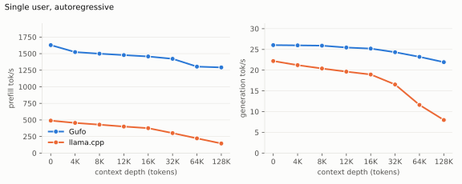
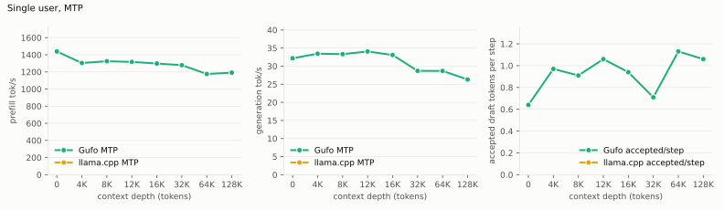
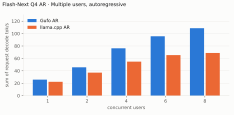
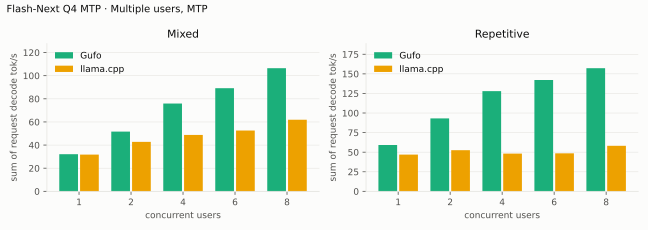
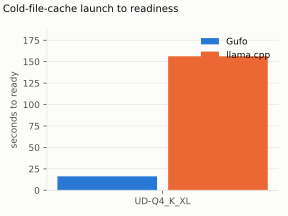
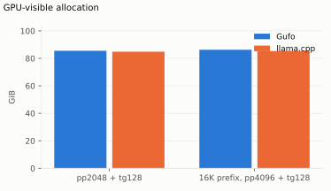

# Qwen3.8 Flash-Next benchmarks

AMD Strix Halo `gfx1151`, 128 GB unified memory. Unsloth `UD-Q4_K_XL` target and
shared-Q8_0 MTP sidecar; Gufo uses adaptive MTP. HTTP (direct `gufo bench` for
the long-context sweep), greedy, thinking off.
Gufo single-user MTP, concurrency, loading and llama.cpp MTP at 64K/128K:
September 23, 2026; other results: September 22; direct 8K-256K sweep:
October 20, 2026; bubo comparison: October 21, 2026.
llama.cpp uses `b11069` for AR and `6fcaa16f` for MTP.

Positive gain favors Gufo.
[Quality and measurement details](QUALITY.md#benchmark-method) · [Model identities](artifacts/model-identities.json)

## Single user, autoregressive

Approximately pp2048 / tg128; depth is the cached prefix in tokens.
Context capacities differ between engines; see the measurement details.

<!-- bench:single-ar -->
| Flash-Next Q4 AR<br>Depth (tokens) | Gufo pp (tok/s) | llama.cpp pp (tok/s) | Gain | Gufo tg (tok/s) | llama.cpp tg (tok/s) | Gain |
| ---: | ---: | ---: | ---: | ---: | ---: | ---: |
| 0 | 1628.52 | 489.59 | +232.6% | 26.04 | 22.20 | +17.3% |
| 4,096 | 1523.39 | 455.24 | +234.6% | 25.98 | 21.21 | +22.5% |
| 8,192 | 1499.13 | 428.85 | +249.6% | 25.91 | 20.40 | +27.0% |
| 12,288 | 1477.98 | 400.21 | +269.3% | 25.46 | 19.64 | +29.6% |
| 16,384 | 1457.16 | 375.89 | +287.7% | 25.20 | 18.95 | +33.0% |
| 32,768 | 1421.93 | 301.31 | +371.9% | 24.33 | 16.54 | +47.1% |
| 65,536 | 1304.01 | 221.94 | +487.6% | 23.21 | 11.62 | +99.7% |
| 131,072 | 1292.02 | 144.78 | +792.4% | 21.93 | 7.98 | +174.8% |
<!-- /bench -->



## Single user, MTP

pp is the highest measured rate per engine and depth across mixed/repetitive
text, including Gufo predictor catch-up.

<!-- bench:single-mtp -->
| Flash-Next Q4 MTP<br>Depth (tokens) | Gufo pp (tok/s) | llama.cpp pp (tok/s) | Gain pp | Gufo tg mixed (tok/s) | llama.cpp tg mixed (tok/s) | Gain mixed | Gufo tg repetitive (tok/s) | llama.cpp tg repetitive (tok/s) | Gain repetitive |
| ---: | ---: | ---: | ---: | ---: | ---: | ---: | ---: | ---: | ---: |
| 0 | 1602.82 | 468.76 | +241.9% | 32.18 | 31.73 | +1.4% | 59.41 | 48.12 | +23.5% |
| 4,096 | 1506.32 | 423.79 | +255.4% | 34.57 | 34.48 | +0.3% | 47.92 | 45.71 | +4.8% |
| 8,192 | 1492.95 | 394.98 | +278.0% | 34.97 | 32.20 | +8.6% | 50.02 | 44.31 | +12.9% |
| 12,288 | 1488.03 | 365.91 | +306.7% | 35.18 | 32.32 | +8.8% | 39.95 | 43.53 | -8.2% |
| 16,384 | 1471.81 | 341.98 | +330.4% | 33.84 | 32.07 | +5.5% | 50.55 | 43.66 | +15.8% |
| 32,768 | 1449.56 | 277.61 | +422.2% | 30.67 | 25.41 | +20.7% | 46.81 | 39.28 | +19.2% |
| 65,536 | 1316.70 | 208.04 | +532.9% | 31.78 | 19.65 | +61.7% | 45.12 | 27.75 | +62.6% |
| 131,072 | 1335.91 | 135.42 | +886.5% | 28.12 | 14.63 | +92.2% | 42.32 | 20.96 | +101.9% |
<!-- /bench -->



## Long-context sweep, direct

`gufo bench`, greedy, one process at a time (the 96 GB carve holds one Q4 model
and its state). Unsloth `UD-Q4_K_XL` + shared-Q8_0 MTP, revision
`38bb39ee97821de2c9009abb7e93950eec396e66`. Two timed repetitions after one
untimed pass. Prefill and AR decode use an autoregressive session; MTP decode
uses adaptive MTP (7 draft tokens, minimum 1).

The 256K row prefill is 262,143 tokens and decode depth is 262,015: the
262,144-token native context needs the extra slot for the next token and 128
generated tokens. Other rows use the exact context.

<!-- bench:context-sweep -->
| Flash-Next Q4<br>Context (tokens) | Prefill pp (tok/s) | Decode AR (tok/s) | Decode MTP (tok/s) | MTP accepted |
| ---: | ---: | ---: | ---: | ---: |
| 8,192 | 1631.19 ± 10.97 | 28.27 ± 0.37 | 45.36 ± 1.45 | 64% (78/122) |
| 32,768 | 1571.90 ± 2.11 | 27.19 ± 0.14 | 78.42 ± 2.72 | 100% (111/111) |
| 131,072 | 1506.40 ± 0.25 | 25.41 ± 0.10 | 75.16 ± 2.21 | 100% (111/111) |
| 262,144 | 1446.26 ± 2.00 | 24.09 ± 0.23 | 71.95 ± 2.11 | 100% (111/111) |
<!-- /bench -->

The bench prompt repeats a 20-token pattern. From 32K the model continues that
pattern verbatim, so MTP accepts almost every draft and the MTP column is an
upper bound for repeated text, not chat or code. The mixed-prompt MTP table
above (28-35 tok/s at depth) is the realistic decode range; the AR column is
the no-speculation reference.

`start.cmd` additionally enables survival stopping, the Latin draft vocabulary
and prompt lookup, and samples at temperature 1.0. `gufo bench` cannot set those
switches, so served rates differ; measure those over HTTP with
`tools/serving/gufo-serving-bench.py`.

```powershell
# Prefill C new tokens, then decode at depth C (AR), then with MTP.
# C = 8192, 32768, 131072, 262144; use C-1 and C-129 at 256K.
gufo bench -m $model -p C      -n 128 -d 0 -r 2 --temperature 0
gufo bench -m $model -p 1      -n 128 -d C -r 2 --temperature 0
gufo bench -m $model -p 1      -n 128 -d C -r 2 --temperature 0 `
  --speculative mtp --mtp-model $mtp
```

`tools/windows/bench-flash-next-context.ps1` runs the whole sweep sequentially
and writes one log per run to `artifacts/bench-context/`. One-page report:
[bench-context.html](bench-context.html).

Run notes for future sweeps:

- Run one benchmark process at a time. The 96 GB GPU carve leaves no room for
  two Q4 instances. Model loads observed here took 47-156 s, so a full sweep
  costs tens of minutes even though the timed runs are short.
- `-p` is new prefill work; `-d` is cached depth. Bench sizes the context as
  `max(4096, depth + prompt + 1, max(depth, 16) + generation + 1)`. At the
  native limit use prompt 262,143 and depth 262,015 with `-n 128`.
- Flash-Next benches only support concurrency 1.
- The checkpoint declares 262,144 context tokens; `start.cmd` serves 131,072 by
  default. The sweep raises the server context per run.
- About 26.8 GiB of the 103.7 GiB checkpoint is the PLE n-gram table, streamed
  from disk. Roughly 76.9 GiB stays resident, which is why 256K state fits the
  96 GB carve.
- The script picks the newest Hugging Face snapshot that has both the first
  `UD-Q4_K_XL` shard and the shared-Q8_0 MTP sidecar; override with `-Model`,
  `-Mtp`, `-Sizes` or `-Repetitions`. Use `-Exe` for another engine binary, for
  example `-Exe C:\dev\bubo\bin\bubo.exe -OutDir
  artifacts\bench-context-bubo`.
- 8K MTP acceptance (64%) is the only row below 90%. From 32K the fixed bench
  pattern is repeated verbatim, so the MTP column is a repeated-text upper
  bound, not chat or code throughput.

### Bubo comparison

Bubo `0.1.0` (`bubo-engine` 0.10.0, revision `3ff74dce`) on the same snapshot
and bench command: greedy, one process at a time, two timed repetitions after
one untimed pass. The 256K row uses the same 262,143 prompt and 262,015 depth.

<!-- bench:bubo-context-sweep -->
| Flash-Next Q4<br>Context (tokens) | Bubo pp | Gufo pp | Bubo AR | Gufo AR | Bubo MTP | Gufo MTP |
| ---: | ---: | ---: | ---: | ---: | ---: | ---: |
| 8,192 | 1540.60 ± 6.52 | 1600.90 ± 13.44 | 27.81 ± 0.08 | 26.70 ± 2.33 | 33.96 ± 0.21 | 42.25 ± 0.42 |
| 32,768 | 1479.29 ± 3.27 | 1542.13 ± 2.74 | 27.52 ± 0.10 | 27.16 ± 0.20 | 67.36 ± 0.96 | 75.38 ± 0.97 |
| 131,072 | 1381.13 ± 1.22 | 1473.04 ± 1.73 | 26.59 ± 0.04 | 25.24 ± 0.03 | 64.33 ± 0.65 | 75.02 ± 0.96 |
| 262,144 | 1293.86 ± 1.87 | 1405.18 ± 0.57 | 25.74 ± 0.04 | 23.88 ± 0.02 | 61.84 ± 0.75 | 72.58 ± 0.91 |
<!-- /bench -->

All values are tok/s. Bubo prefill is 3.8-7.9% lower, AR decode is 1.3-7.8%
higher, and MTP decode is 10.6-19.6% lower than Gufo across the sweep. The
256K MTP run accepted 111/111 drafts (100%), so the repeated-text caveat above
applies to both engines. Bubo's serving launcher also enables survival, Latin
draft vocabulary, lookup and vision; these direct bench numbers do not.
One-page report: [bench-context-bubo.html](bench-context-bubo.html).

## Multiple users, autoregressive

Same pp2048 prose prompt as single-user d0, tg128, context 4096 per user.
All sessions prefilled before timed decoding; throughput sums individual rates.
llama.cpp re-evaluates its four-token checkpoint tail.

<!-- bench:multi-ar -->
| Flash-Next Q4 AR<br>Users | Gufo AR (tok/s) | llama.cpp AR (tok/s) | Gain |
| ---: | ---: | ---: | ---: |
| 1 | 25.85 | 22.34 | +15.7% |
| 2 | 45.70 | 37.08 | +23.2% |
| 4 | 76.29 | 54.82 | +39.2% |
| 6 | 95.66 | 65.34 | +46.4% |
| 8 | 108.67 | 68.79 | +58.0% |
<!-- /bench -->



## Multiple users, MTP

Same pp2048 mixed/repetitive prompts as single-user d0, tg128, context 4096
per user. All sessions prefilled before timed decoding; rates sum individual
request decode rates. C1 cross-checks the single-user table.

<!-- bench:multi-mtp -->
| Flash-Next Q4 MTP<br>Users | Gufo mixed (tok/s) | llama.cpp mixed (tok/s) | Gain | Gufo repetitive (tok/s) | llama.cpp repetitive (tok/s) | Gain |
| ---: | ---: | ---: | ---: | ---: | ---: | ---: |
| 1 | 32.09 | 31.77 | +1.0% | 59.20 | 46.93 | +26.1% |
| 2 | 51.68 | 42.79 | +20.8% | 93.16 | 52.57 | +77.2% |
| 4 | 75.92 | 48.78 | +55.6% | 127.91 | 48.23 | +165.2% |
| 6 | 89.18 | 52.59 | +69.6% | 142.14 | 48.51 | +193.0% |
| 8 | 106.47 | 61.92 | +71.9% | 157.22 | 58.13 | +170.5% |
<!-- /bench -->



## Loading time

C1, context capacity 262144, MTP. Cold target/sidecar files to HTTP readiness.

<!-- bench:loading -->
| Flash-Next Q4<br>Target | Gufo ready (s) | llama.cpp ready (s) | Gain |
| --- | ---: | ---: | ---: |
| Q4 | 15.45 | 117.83 | +662.7% |
<!-- /bench -->



## Memory occupation

C1, context capacity 133121, AR. Peak memory reported by HIP.

<!-- bench:memory -->
| Flash-Next Q4 AR<br>Workload | Gufo GiB | llama.cpp GiB | Gain |
| --- | ---: | ---: | ---: |
| pp2048 + tg128 | 85.55 | 84.84 | -0.8% |
| 16K prefix, pp4096 + tg128 | 86.27 | 85.31 | -1.1% |
<!-- /bench -->


